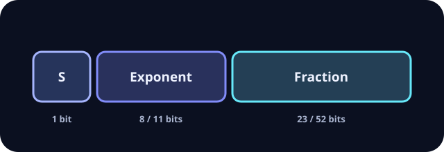

<div align="center">


<p><strong>Explore binary32 and binary64 representations in your browser.</strong></p>
   
<br/>
</div>

## 🧭 Overview
Floating Point Lab converts a decimal input into its IEEE 754 binary32 or binary64 bit pattern. It displays the sign, exponent, fraction, decoded value, rounding error, and local ULP spacing.

## ✨ Features
- 🔢 Inspect 32-bit and 64-bit representations.
- 🧩 Separate sign, exponent, and fraction fields.
- 📐 Compare the stored value with the original input.
- 🧮 Estimate the ULP spacing at the selected magnitude.
- 🔒 Perform all calculations locally in the browser.

## 🎬 Demo
Start the app and try 0.1, 0.2, 0.3, or 16777217 in binary32 mode to see rounding behavior.

## 🚀 Quick Start
Requires Node.js 20 or newer.

```bash
npm start
```

Open http://127.0.0.1:4175. Run checks with npm test.

## 🧰 Tech Stack
- 🟢 Node.js built-in HTTP server
- 🌐 Browser JavaScript DataView API
- 🧪 Node.js built-in test runner

## 🗂️ Folder Structure
```text
public/       Bit inspector interface and conversion logic
test/         Representation tests
assets/       Original SVG artwork
.github/      CI workflow
server.js     Dependency-free static server
```

## 🛣️ Roadmap
- [ ] Add hexadecimal and binary input modes.
- [ ] Visualize neighboring representable values.
- [ ] Add special-value examples for infinities and NaN.

## 🤝 Contributing
Contributions are welcome. Keep conversions based on IEEE 754 primitives and add tests for normal, subnormal, and boundary values.

## 📄 License
MIT. See LICENSE.

<div align="center"></div>
